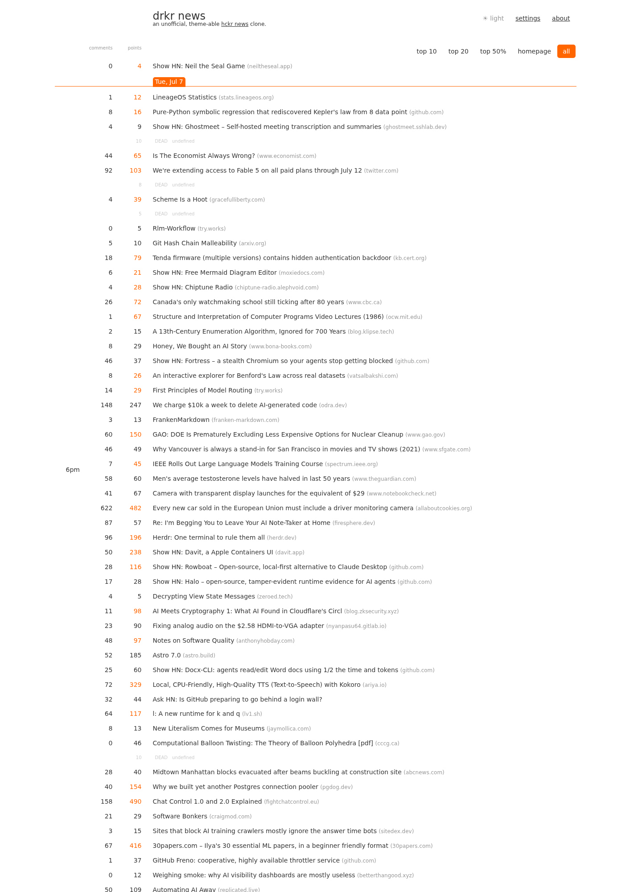

# drkr news

A clone of [hckrnews.com](https://hckrnews.com/) — Hacker News sorted by
time — with dark mode and customizable themes.



## Run it

It's a static site; serve the directory and open it:

```sh
python3 -m http.server 8347
# http://localhost:8347
```

(Opening `index.html` via `file://` also works in most browsers, since all
data is fetched from CORS-enabled APIs.)

## Deployment

It's a pure static site — no backend and no build step — so any static file
server or static host serves it; running the directory as shown above is all
it takes.

The one gotcha: assets aren't content-hashed, so they're referenced as
`css/style.css?v=N` and `js/app.js?v=N`. When you change `css/style.css` or
`js/app.js`, **bump `N` in both `index.html` and `about.html`** — that version
bump is what busts browser and iOS-PWA caches. That's the whole deploy step.

## Features

Faithful to the original:

- Stories sorted by submission time, grouped by day with orange day tabs and
  6am/12pm/6pm markers in the left gutter
- Filters: **top 10**, **top 20**, **top 50%** (per-day score thresholds),
  **homepage**, **all**
- Comments/points columns linking to the thread; points highlighted when a
  story reaches the front page; unread-comment counts (`12 / 146`) for
  threads you've opened before
- "last visit" marker, infinite scroll into previous days, auto-refresh with
  an "N new stories" link
- Settings: HackerWeb comment links, open links in a new window, show dead
- Responsive: same desktop / tablet / phone breakpoints as the original

New here:

- **Dark mode** — auto (follows the system), light, or dark; toggle in the
  header or in settings
- **Themes** — pick a light theme (classic, sepia, solarized light) and a
  dark theme (drkr, dracula, nord, solarized dark, terminal) independently
- **Accent color** — override the hn orange with any color

All preferences persist in `localStorage`.

## Data sources

hckrnews is "a chronologic list of items that have made it onto the Hacker
News homepage": its crawler records when each story first reaches the front
page (`date`), shows only those stories, sorts by that moment (not
submission time), and groups them into UTC-day files.

The clone reproduces this exactly for the visible feed:

- **hckrnews.com's own feed** (`/data/latest.js`) — loaded cross-origin as a
  plain `<script>` (it's JSONP-style). Covers the current + previous UTC
  day: identical stories, order, homepage flags, and dead entries.
- **[HN Algolia API](https://hn.algolia.com/api)** — older days reached by
  infinite scroll are approximated (front-page arrival times aren't public):
  stories submitted that UTC day with ≥20 points, ordered by submission
  time. Fitted against real hckrnews day files (F1 ≈ 0.7). Also the full
  fallback if the feed is unreachable.
- **[Official Firebase API](https://github.com/HackerNews/API)** — current
  top-30 list, used for the homepage flag on approximated days.

Like the original, day tabs and 6am/12pm/6pm markers follow your local
clock, while the top 10/20/50% thresholds are computed per UTC day file.

## URL parameters

`?theme=dracula`, `?mode=dark`, `?filter=10`, `?settings=open` — handy for
sharing and screenshots.
