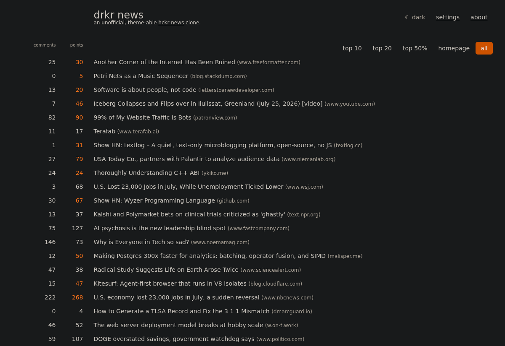

# drkr news

A clone of [hckrnews.com](https://hckrnews.com/), Hacker News sorted by
time, with dark mode and themes. Plain HTML, CSS and JavaScript: no build
step, no framework, no backend.



## Run it

```sh
python3 -m http.server 8347   # then open http://localhost:8347
```

Any static file server works, and so does opening `index.html` directly.

## Features

From the original:

- Stories grouped by day, with 6am/12pm/6pm markers in the gutter
- Filters: top 10, top 20, top 50%, homepage, all
- Points turn orange while a story is on the front page; threads you've
  opened show unread comments (`12 / 146`)
- A last-visit marker, infinite scroll back 14 days, and auto-refresh with
  an "N new stories" link
- Settings: HackerWeb comment links, open in new window, show dead
- The original's desktop, tablet and phone layouts

Added:

- Dark mode: auto (follows the system), light or dark
- Separate light themes (classic, sepia, solarized light) and dark themes
  (drkr, dracula, nord, solarized dark, terminal)
- A custom accent color in place of the orange
- Optional redirects for login-walled sites (below)

Settings are stored in localStorage. No accounts, no tracking.

## Redirects

Off by default. When you switch it on in settings, story links to sites
that hide content from signed-out visitors point to an alternative front
end instead:

| Site | Front end | Default once on |
| --- | --- | --- |
| X / Twitter | Nitter | on |
| Reddit | Redlib | on |
| Instagram | Imginn | on |
| Medium | Freedium, Scribe | on |
| Quora | Quetre | on |
| TikTok | ProxiTok | off: most instances are dead |
| Paywalled news (19 sites) | archive.today | off: frequent captchas |
| YouTube | Invidious, Piped | off |
| Stack Overflow / Exchange | AnonymousOverflow | off |
| Fandom | BreezeWiki | off |
| Imgur | rimgo | off |
| Wikipedia | Wikiless | off |

**customize** opens the per-service list. Each service has its own switch,
a choice of public instances and a `custom…` field, since instances go down
often.

A rewritten link still shows the story's own domain, with a dotted
underline and a tooltip naming the instance. Alt-click it to open the
original. Only story links are affected (comment links follow the
HackerWeb setting), and nothing goes through a proxy. Services and instances are defined in `FRONTENDS` in `js/app.js`.

## Data

hckrnews lists only stories that made the HN front page, sorted by when
they first reached it (not when they were submitted). The clone uses:

- **hckrnews.com's own feed** (`/data/latest.js`) for the current and
  previous UTC day, so recent days match the original exactly. It's
  JSONP-style, so it loads as a `<script>`, and is re-polled every 4
  minutes.
- **[HN Algolia](https://hn.algolia.com/api)** for older days, and as the
  fallback when the feed is down. Front-page arrival times aren't public,
  so these days are approximated: stories submitted that UTC day with at
  least 20 points (10 in the fallback), sorted by submission time. Checked
  against real hckrnews day files, this scores F1 ≈ 0.7.
- **[HN Firebase API](https://github.com/HackerNews/API)**: the current top
  30, which sets the homepage flag on approximated days.

As on the original, day tabs and time markers use your local clock, while
the top 10/20/50% cutoffs are computed per UTC day.

## URL parameters

Useful for sharing and screenshots: `?mode=auto|light|dark`,
`?theme=<name>`, `?filter=10|20|half|homepage|all`, `?settings=open`,
`?redirects=on|off|open` (`open` expands the per-service list).

## Deploying

Copy the directory to any static host. Assets aren't content-hashed, so
they carry a version (`css/style.css?v=N`, `js/app.js?v=N`): bump `N` in
both `index.html` and `about.html` whenever you change one.

Every visitor's browser fetches the feed from hckrnews.com and re-polls it
every 4 minutes. That's fine for a personal instance, but for real traffic,
cache the feed yourself and point `FEED` in `js/app.js` at your copy. Both
pages set a strict Content-Security-Policy, so also add the new origin to
`script-src` in `index.html`, or the browser will block it.

## Credits and license

Interface and behavior reverse-engineered from Wayne Larsen's
[hckrnews.com](https://hckrnews.com/). Not affiliated with hckrnews.com or
Y Combinator. Code is [MIT licensed](LICENSE).
