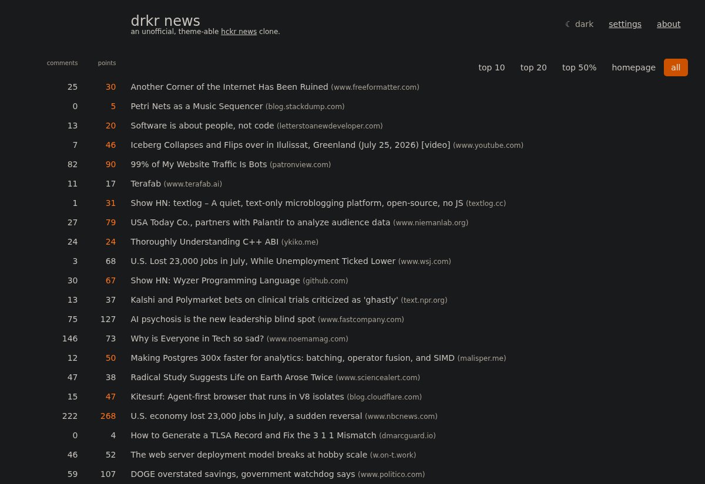

# drkr news

A clone of [hckrnews.com](https://hckrnews.com/) - Hacker News sorted by
time - with dark mode and customizable themes. Plain HTML, CSS, and
JavaScript: no build step, no framework, no backend.



## Run it

Serve the directory with any static file server:

```sh
python3 -m http.server 8347
# open http://localhost:8347
```

Opening `index.html` via `file://` also works in most browsers, since all
data comes from CORS-enabled APIs.

## Features

Everything the original does:

- Stories sorted chronologically, grouped by day, with orange day tabs and
  6am/12pm/6pm markers in the left gutter
- Filters: top 10, top 20, top 50% (per-day score thresholds), homepage, all
- Comments and points columns linking to the thread; points turn orange
  while a story is on the front page; unread-comment counts (`12 / 146`)
  for threads you've opened before
- A "last visit" marker, infinite scroll back through previous days (up to
  14), and auto-refresh with an "N new stories" link
- Settings: HackerWeb comment links, open links in a new window, show dead
- The original's desktop, tablet, and phone breakpoints

New here:

- Dark mode: auto (follows your system), light, or dark, toggled in the
  header or in settings
- Themes: pick a light theme (classic, sepia, solarized light) and a dark
  theme (drkr, dracula, nord, solarized dark, terminal) independently
- Accent color: replace the orange with any color you like
- Redirects: switch it on and story links to login-walled sites resolve to
  an alternative front end (see below)

Preferences persist in localStorage. No accounts, no tracking.

## Redirects

Some sites withhold the thing you clicked for until you sign in - X hides
the replies, Reddit's mobile site drops an app wall over the thread, Medium
meters the article. Switch this on and story links to those sites are
rewritten to an alternative front end that serves the same content without
the wall:

| Site | Front end | Once switched on |
| --- | --- | --- |
| X / Twitter | Nitter | on |
| Reddit | Redlib | on |
| Instagram | Imginn | on |
| Medium | Freedium, Scribe | on |
| Quora | Quetre | on |
| TikTok | ProxiTok | off - instances are mostly dead |
| YouTube | Invidious, Piped | off |
| Stack Overflow / Exchange | AnonymousOverflow | off |
| Fandom | BreezeWiki | off |
| Imgur | rimgo | off |
| Wikipedia | Wikiless | off |
| Paywalled news (19 domains) | archive.today | off |

The whole feature is off until you turn it on; nothing is rewritten behind
your back. What it rewrites once on is the rule in that last column: sites
that hide basic reading from signed-out visitors, and nothing else.
**Settings** carries the switch and a line naming what's on; **customize**
opens the per-service list, where each has its own switch, a choice of public
instances, and a `custom…` field - because instances come and go constantly,
and when one stops answering you want another.

A rewritten link still shows the story's own domain, marked with a dotted
underline whose tooltip names the front end. **Alt-click** it to open the
original site instead. Only the story link is affected; the comments column
is the HackerWeb setting's business. Nothing is proxied: the browser goes
straight to the instance you picked.

Adding a service, or changing which instances are offered, is a matter of
editing the `FRONTENDS` registry at the top of `js/app.js`.

## Data sources

hckrnews is "a chronologic list of items that have made it onto the Hacker
News homepage": its crawler records when each story first reaches the front
page, shows only those stories, sorts by that moment (not submission time),
and groups them into UTC-day files.

The clone reproduces this exactly for the visible feed:

- [hckrnews.com](https://hckrnews.com)'s own feed (`/data/latest.js`),
  loaded cross-origin as a plain `<script>` (it's JSONP-style). It covers
  the current and previous UTC day: identical stories, order, homepage
  flags, and dead entries.
- The [HN Algolia API](https://hn.algolia.com/api) for older days reached
  by infinite scroll. Front-page arrival times aren't public, so these days
  are approximated: stories submitted that UTC day with at least 20 points,
  ordered by submission time. Fitted against real hckrnews day files
  (F1 about 0.7). It is also the fallback if the feed is unreachable, there
  at a gentler 10-point bar so today and yesterday still fill up.
- The [official Firebase API](https://github.com/HackerNews/API) for the
  current top-30 list, which supplies the homepage flag on approximated
  days.

Like the original, day tabs and 6am/12pm/6pm markers follow your local
clock, while the top 10/20/50% thresholds are computed per UTC day.

## URL parameters

`?theme=dracula`, `?mode=dark`, `?filter=10`, `?settings=open`,
`?redirects=off` (or `open`, to expand the per-service list) - handy for
sharing and screenshots.

## Deploying

Copy the directory to any static host. One caveat: assets aren't
content-hashed, so they're referenced as `css/style.css?v=N` and
`js/app.js?v=N`. When you change one of those files, bump its `N` in both
`index.html` and `about.html` to bust browser caches. That's the whole
deploy step.

Worth knowing before you stand up a copy: every visitor's browser loads the
feed from hckrnews.com directly and re-polls it every four minutes, so a
deployment leans on someone else's server rather than on yours. That is fine
for a personal instance and rude at scale - if you expect real traffic, cache
the feed yourself and point `FEED` in `js/app.js` at your own copy. Both pages
ship a strict `Content-Security-Policy` `<meta>`, so if you re-point `FEED` (or
add a data source), allow the new origin in the CSP's `script-src`/`connect-src`
in `index.html` - otherwise the browser blocks it.

## Credits and license

Interface and behavior reverse-engineered from Wayne Larsen's
[hckrnews.com](https://hckrnews.com/). Not affiliated with hckrnews.com or
Y Combinator. Code is [MIT licensed](LICENSE).
